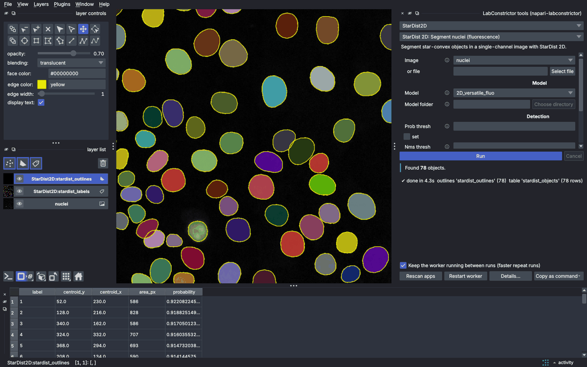
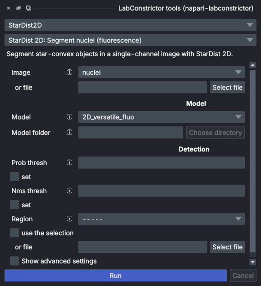

# LabConstrictor for napari

Run the analysis tools of your LabConstrictor apps from inside [napari](https://napari.org). Open the **LabConstrictor tools** panel, pick an app and a tool, choose an image layer and press **Run**. The results come back as napari layers and tables. The analysis runs in the app's own Python environment, so you do not install the app's packages into napari.



*The StarDist2D app's "Segment nuclei" tool, run from napari on an open image layer.*

> **Experimental.** This is an alpha pre-release (`v0.1.0-alpha.5`). It has been tested on Linux, Windows and macOS, but expect bugs and changes. Please [tell us](https://github.com/CellMigrationLab/LabConstrictor-napari/issues) what you find.

## Install

You need napari running on **Python 3.11 or newer** with a Qt6 backend, and at least one LabConstrictor app.

1. **Install a LabConstrictor app** from the [App Centre](https://cellmigrationlab.github.io/LabConstrictor-Site/apps/?host=napari). Its installer registers the app on your computer, which is how the plugin finds it.
2. **Install the plugin** in the Python environment you start napari from:

   ```bash
   pip install "napari[pyqt6]" \
     https://github.com/CellMigrationLab/LabConstrictor-Tools/archive/refs/tags/v0.3.0-alpha.2.zip \
     https://github.com/CellMigrationLab/LabConstrictor-napari/archive/refs/tags/v0.1.0-alpha.5.zip
   ```

3. **Restart napari.**

The plugin is not on PyPI yet, so it is installed from these two addresses. Newer versions appear on the [Releases page](https://github.com/CellMigrationLab/LabConstrictor-napari/releases).

## First use



1. Open an image in napari.
2. Choose **Plugins > LabConstrictor tools**.
3. Pick an app, then a tool. The form shows that tool's settings; hover over an **ⓘ** to read what a setting means.
4. Choose the image layer (or a file) and press **Run**. A progress bar and a **Cancel** button are there while the tool runs.
5. Look at the results: new layers in the layer list, a table below the viewer, and a short summary under the Run button.

No data at hand? Install the [Playground](https://github.com/CellMigrationLab/LabConstrictor-Playground) app and run its **Feature tour** tool without choosing an image: it makes its own demo image.

<br clear="right">

The step-by-step guide, with troubleshooting, is on the website: [Install the napari plugin](https://cellmigrationlab.github.io/LabConstrictor-Site/guides/napari/).

## Apps that work in napari

| App | What it does |
|---|---|
| [StarDist2D](https://cellmigrationlab.github.io/LabConstrictor-Site/apps/stardist2d/) | Segment nuclei and cells in 2D images with StarDist |
| [NucleiSky](https://cellmigrationlab.github.io/LabConstrictor-Site/apps/nucleisky/) | Align microscopy images by matching the pattern of their nuclei |
| [Guess the Condition](https://cellmigrationlab.github.io/LabConstrictor-Site/apps/guessthecondition/) | A blinded test of whether conditions can be told apart by eye |
| [VLab4Mic](https://cellmigrationlab.github.io/LabConstrictor-Site/apps/labconstrictor-vlab4mic/) | Simulate fluorescence microscopy images of virtual samples |
| [Playground](https://cellmigrationlab.github.io/LabConstrictor-Site/apps/labconstrictor-playground/) | Check your computer and try every feature of the plugin |

Any LabConstrictor app that declares napari as one of its hosts appears in the panel; no extra plugin is needed per app. The [App Centre](https://cellmigrationlab.github.io/LabConstrictor-Site/apps/?host=napari) has the current list.

## Getting help

- **Something failed?** The line under the Run button says what went wrong, and **Details...** shows the full report.
- **Guides:** the [LabConstrictor website](https://cellmigrationlab.github.io/LabConstrictor-Site/) and its [guides](https://cellmigrationlab.github.io/LabConstrictor-Site/guides/).
- **Bugs and questions:** the [issue tracker](https://github.com/CellMigrationLab/LabConstrictor-napari/issues).

## More detail

- [Using LabConstrictor in napari](docs/USING_NAPARI.md): image inputs, channels, pixel size, selections, where results are drawn, run records.
- [Technical reference](docs/REFERENCE.md): the rules behind the form and the results, and notes for developers.
- The same apps also run in [Fiji](https://github.com/CellMigrationLab/LabConstrictor-Fiji) and [QuPath](https://github.com/CellMigrationLab/LabConstrictor-QuPath). To make your own app, start at the [LabConstrictor website](https://cellmigrationlab.github.io/LabConstrictor-Site/).

## For developers

The repository is `LabConstrictor-napari`; the Python package is `napari-labconstrictor`. To run the tests:

```bash
pip install https://github.com/CellMigrationLab/LabConstrictor-Tools/archive/refs/tags/v0.3.0-alpha.2.zip
pip install -e ".[test-pyqt6]"            # or ".[test-pyside6]"; one Qt backend per environment
cd tests
for t in test_*.py; do python "$t" || echo "FAILED: $t"; done   # on Linux without a display: xvfb-run -a python "$t"
```

Each `tests/test_*.py` is a standalone script, and they use a small example app, so no scientific app needs to be installed. Linting, type checks and releasing are described in the [technical reference](docs/REFERENCE.md#development) and in [tests/README.md](tests/README.md).

License: [MIT](LICENSE).
