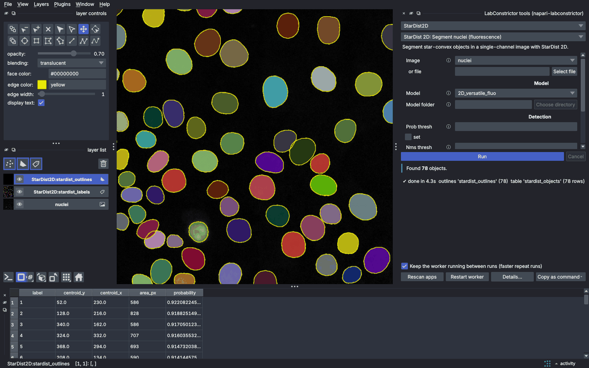
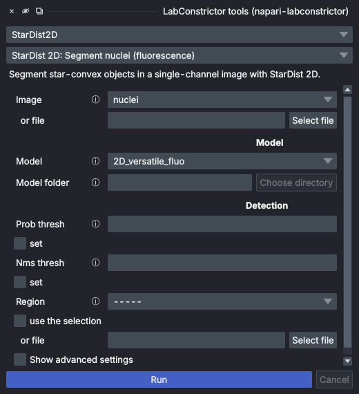

# Install the napari plugin

Run the tools of your LabConstrictor apps from napari: one panel lists every installed app, you pick a tool, and its results come back as napari layers and tables.



## What you need

- [napari](https://napari.org), running on **Python 3.11 or newer** with a Qt6 backend (`napari[pyqt6]` or `napari[pyside6]`; PyQt5 is not tested).
- At least one LabConstrictor app that works in napari. The [App Centre](https://cellmigrationlab.github.io/LabConstrictor-Site/apps/?host=napari) lists them. Installing the app and installing this plugin are two separate steps: the app's installer registers the app on your computer, which is how the plugin finds it.

## Install

1. **Open the Python environment you start napari from.** Open a terminal (on Windows, the Anaconda Prompt or Miniforge Prompt if you use conda). If you start napari after `conda activate <name>`, or after activating a virtual environment, activate that environment first:

   ```bash
   conda activate <name>
   ```

   If you do not have one yet, create an environment with Python 3.11 or newer and activate it, for example with conda:

   ```bash
   conda create -n napari-env python=3.12
   conda activate napari-env
   ```

   If you installed napari with its desktop installer, follow [napari](https://napari.org)'s instructions for adding packages to that installation instead.

2. **Install napari, the plugin and the package it needs.** In that environment, run the command for your system.

   **Windows** (Anaconda Prompt, Command Prompt or PowerShell), on one line:

   ```powershell
   pip install "napari[pyqt6]" https://github.com/CellMigrationLab/LabConstrictor-Tools/archive/refs/tags/v0.3.0-alpha.4.zip https://github.com/CellMigrationLab/LabConstrictor-napari/archive/refs/tags/v0.1.0-alpha.5.zip
   ```

   **macOS and Linux** (Terminal):

   ```bash
   pip install "napari[pyqt6]" \
     https://github.com/CellMigrationLab/LabConstrictor-Tools/archive/refs/tags/v0.3.0-alpha.4.zip \
     https://github.com/CellMigrationLab/LabConstrictor-napari/archive/refs/tags/v0.1.0-alpha.5.zip
   ```

3. **Restart napari.** Close every napari window, then start napari again from the same environment:

   ```bash
   napari
   ```

> [!NOTE]
> **Why two addresses.** The plugin is not on PyPI yet, so it is installed from two release archives: the first is LabConstrictor-Tools, a package the plugin needs, the second is the plugin. You do not need `git`. Newer versions appear on the [Releases page](https://github.com/CellMigrationLab/LabConstrictor-napari/releases); to update, put the newest version in the second address and run the command again.

## Open it

1. Open an image in napari.
2. Choose **Plugins > LabConstrictor tools**. The panel lists the apps installed on your computer.
3. Pick an app, then a tool. The form shows the tool's settings; hover over an **ⓘ** to read what a setting means.
4. Choose the image and press **Run**.



## What you get back

- **Layers.** Images, labels, points and outlines appear as new layers, drawn on top of the image they came from.
- **Tables** open in a dock below the viewer.
- **Messages and values** appear under the Run button.
- **Nothing found** is shown as a notice, not as an error.
- **Files the tool wrote** are kept in a folder under `~/.labconstrictor/results`, and the line under the Run button shows its path.

Very large results are not shown in full: an image over 4 GB is not loaded, a table shows at most 100 000 rows and at most 50 000 outlines are drawn. The tool's own files hold everything.

> [!TIP]
> **Good to know.**
>
> - An image input takes an open layer or a file. If you give both, the file is used. TIFF and OME-TIFF files always work; other formats work only if the app can read them.
> - A pixel-size setting is filled in from the image when the image says its pixel size. If it does not, the field stays empty and you type the value in micrometres.
> - A progress bar and a **Cancel** button are there while a tool runs. Changing layers while it runs does not change the run: it uses what was selected when you pressed **Run**.
> - **Copy as command** gives you the last run as a terminal command or a Python snippet, to repeat it outside napari. If an input was a layer you never saved, save it first.
> - If you install another app while napari is open, press **Rescan apps**.

## Check that it worked

1. Install the [Playground](https://cellmigrationlab.github.io/LabConstrictor-Site/apps/labconstrictor-playground/) app.
2. In napari, choose **Plugins > LabConstrictor tools**. If the panel was already open, press **Rescan apps**.
3. Pick **LabConstrictor Playground**, then its **Feature tour** tool. Do not choose an image: the tool makes its own small demo image.
4. Press **Run**.

You should get a labels layer, outlines, points, a table, and the message "Found 16 blob(s) (the built-in demo image)." under the Run button.

## If something does not work

- **The app list says "(none registered)".** No LabConstrictor app is installed yet, or the app does not offer its tools in napari. Install an app, then press **Rescan apps**.
- **A run fails.** The line under the Run button says what failed; **Details…** shows the full report.
- **The run is refused because the image has no pixel size.** The image does not say how big a pixel is (or only says napari's default `pixel`). Type the pixel size in micrometres in the field, then press **Run** again.
- **A 2D tool refuses your image ("must be a 2D image (YX)").** The image is a stack (Z, time or several channels). Give the tool a single 2D image instead, for example one plane saved as its own file.
- **The results were not drawn and the message says the layer "is no longer open".** You closed or replaced the image while the tool ran. The results are in the folder the message names.
- **A warning says the plugin is too old for an app.** Install the newest plugin version (see Install). If the app requires the newer version, Run stays refused until you do.
- **You want to know which apps are found, and why one is skipped.** Run `labconstrictor-tools doctor` in a terminal, in napari's environment.
- **You want to report a bug.** `labconstrictor-tools support-bundle` makes a zip file with the log; attach it to an [issue](https://github.com/CellMigrationLab/LabConstrictor-napari/issues). The log itself is `~/.labconstrictor/logs/labconstrictor.log`.

How the form is built, where results are placed and what is saved to disk: the [napari plugin reference](https://cellmigrationlab.github.io/LabConstrictor-Site/guides/napari-reference/). Source code and issues: [LabConstrictor-napari](https://github.com/CellMigrationLab/LabConstrictor-napari).
